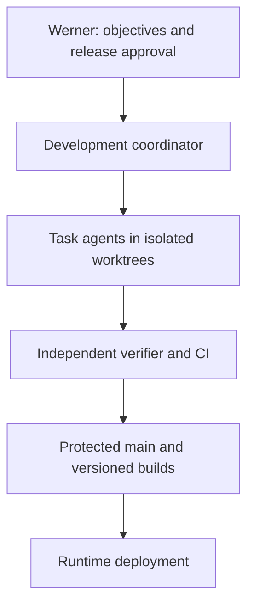
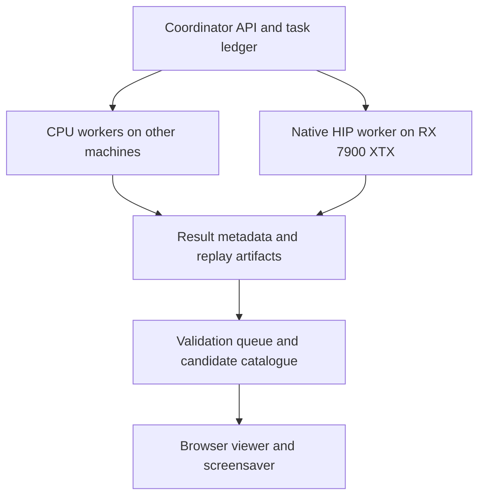

# Architecture

## Objectives and inherited requirements

Explore independent initial states of three equal masses on a 12 × 12 m observation square, starting at rest. The existing model uses inverse-square gravity, with gravitational parameter μ = 9.80665 m³/s² for one mass unit. Thus one isolated base mass produces 1g at 1 m; there is no external downward Earth field.

Enumerate cell triples across the whole square, top-left first, with blue advancing fastest, then green, then red. At radius/grid step 0.25 m there are 47 × 47 = 2,209 centres and 1,794,096,784 distinct unlabelled triples. Preserve the existing omission of equivalent colour permutations. Every initial state has a stable ordinal and can be reconstructed directly.

Display every `Escaped` outcome, irrespective of duration, plus all other outcomes lasting strictly more than five simulated seconds. Exactly five seconds does not satisfy the duration rule. This is a viewer selection rule: workers still compute and account for every assigned trial. Escape means crossing the observation square, not proven gravitational escape to infinity.

The current model stops at a 0.015 m close encounter and does not merge masses. Keep that model version intact during the parallel port. A physical merger is an explicit, separately approved experiment; a later two-body orbit is not a three-body equilibrium solution.

## Two control planes

Development agents are coding/review sessions. Runtime workers are deterministic numerical programs. The runtime does not ask an LLM to solve or classify each trial.

Neither diagram implies an implemented service. The existing Site still uses a serial CPU worker and local browser storage.

## Runtime components

| Component | Proposed implementation | Responsibility |
| --- | --- | --- |
| Reference engine | Existing JavaScript baseline, then C++17 FP64 CLI | Establish numerical behavior before acceleration; emit machine-readable summaries and optional trajectories. |
| Native numerical core | C++17 with CMake; shared host/device-compatible force and integration code | Pairwise gravity, stepping, stopping events, diagnostics; no network or Git logic. |
| HIP backend | Native HIP C++ targeting the detected GPU, expected `gfx1100` | Many independent full trials, resumable step chunks, active-trial compaction. |
| Worker supervisor | Python 3.11+ process | Registration, leases, heartbeat, binary invocation, local spool and uploads. |
| Coordinator | Python service; proposed FastAPI; local SQLite initially | Allocate immutable ordinal ranges, accept fenced results, record coverage and replay jobs. Pin dependencies after P0. |
| Evidence storage | Local filesystem plus metadata ledger | Content-addressed compressed artifacts; no trajectories committed to Git. |
| Viewer | Existing browser canvas adapted to an API and replay queue | Stream selected completed results while computation continues independently. |
| Verification worker | CPU FP64 reference CLI | Recheck candidates, uncertain events, hardware parity and convergence. |

C++/HIP is recommended to share numerical code and expose precision controls directly. Python handles orchestration; it should not execute per-body arithmetic in a Python loop. A Rust coordinator can be reconsidered by ADR if deployment evidence justifies it. WebGPU is a later participation option, not a dependency of the initial native worker.

## Deployment on the 7900 XTX rig

The rig can host the coordinator, evidence store, viewer service and one GPU worker. Additional machines run CPU worker supervisors. Keep the coordinator database on local disk, accessed only through the coordinator process. Remote workers use its API; they do not open a database on SMB/NFS.

The rig is also used for local AI. Schedule one exclusive GPU validation/benchmark slot at a time, with GPU workloads and resident models accounted for. Start with at most three concurrent implementation agents, one independent verification role and one coordinator; reduce concurrency if local RAM or model serving is constrained. A coding agent does not reserve the GPU merely by owning a HIP task.

The OS baseline is an explicit P0 decision: Windows 11 + supported native HIP SDK, or a separately booted Linux environment + a supported ROCm tuple. Do not mix Windows, WSL and native Linux evidence or assume the remembered ROCm 6.2.3 installation is the validated build environment.

## Repository boundaries

Use a dedicated monorepo for solver, coordinator, worker protocol, viewer adapter, tests and documentation. Keep the current published Site as a preserved baseline until the replacement viewer passes parity tests. Deployment from the development repo to the Site is a later release action.

Suggested module paths: `contracts/`, `native/core/`, `native/cli/`, `native/hip/`, `services/coordinator/`, `workers/`, `viewer/`, `verification/`, `tests/fixtures/`, `ops/`, and `docs/adr/`.

## Execution without animation backpressure

Workers process continuously. The viewer maintains its own replay queue and cursor; pausing or closing the viewer must not stop numerical jobs. Show queue depth and give a way to inspect all qualifying records; a growing catalogue does not imply that one viewer can display every qualifying result as quickly as a GPU finds them. No qualifying result should be deleted merely because the viewer is behind.

Record lightweight summaries for every trial. Generate full replays by rerunning selected trial IDs with the same pinned build/configuration. This differs from the current browser's store-every-trajectory approach and avoids billions of replay arrays. Keep all replay job failures and mismatches visible. Unresolved trials require reprocessing or explicit unresolved coverage; they never count as verified negative results.
