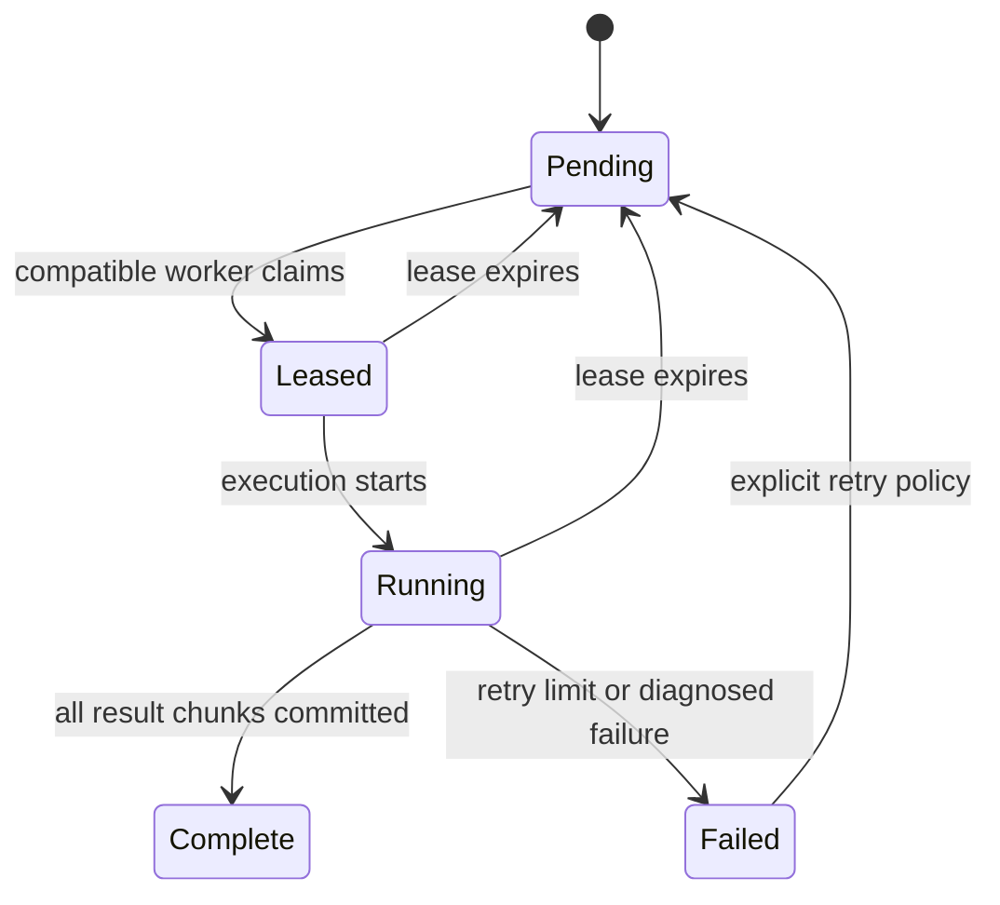

# Detailed design

## Versioned experiment identity

Use a canonical JSON manifest, a named canonicalization algorithm fixed at the contract gate, and SHA-256. Record the manifest bytes as well as the hash. Hash the physical model, grid enumeration version, square, initial masses/velocities, close-encounter threshold, numerical method, maximum time, precision policy, error limits and event definitions. Viewer playback speed is not part of physical experiment identity.

Keep separate identifiers:

- `experiment_id`: immutable model, initial-condition space and numerical policy.
- `trial_id`: experiment ID and ordinal, independent of which machine executes it.
- `task_id`: experiment ID, task kind and half-open ordinal range `[start, end)`.
- `execution_id`: trial ID, solver build, backend, precision, worker identity and attempt ID.
- `lease_epoch`: increasing fencing token for a task allocation.

Transmit ordinals and range endpoints as decimal strings, parsed as unsigned 64-bit integers by native services; use BigInt or checked conversion in the viewer. The current configured grids fit JavaScript safe integers, but that must not silently become a permanent API constraint.

## Task and result contracts

A task specifies a manifest hash, range, pinned executable/build digest, permitted backend/precision, deadline/lease, output policy, and verification policy. Registration reports OS, CPU, RAM, GPU/architecture, driver/runtime/compiler versions, supported precision and measured capacity. Capability matching prevents a CPU-only machine receiving a mandatory HIP job.

A worker receives structured parameters, never arbitrary executable commands from the API. A task envelope describes its known solver executable and validated settings. Worker supervisors should only execute configured binaries.

Each accepted trial summary includes starting state or reconstructable trial ID, stopping reason and time, final state, step count, minimum separation, initial/final energy, maximum energy drift, linear/angular momentum diagnostics, build/environment IDs, and evidence status. Orbit candidates also include the period estimate, observed cycles, recurrence error, tolerances and validation lineage.

Suggested initial endpoints (proposal, not an implemented API):

| Endpoint | Purpose |
| --- | --- |
| `POST /v1/workers/register` | Register identity and capabilities. |
| `POST /v1/leases/acquire` | Atomically lease the next compatible ordinal range. |
| `POST /v1/leases/{id}/heartbeat` | Renew the current epoch with progress. |
| `POST /v1/leases/{id}/results` | Submit a bounded result chunk with epoch and checksum. |
| `POST /v1/leases/{id}/complete` | Finish only after all expected results are durably committed. |
| `GET /v1/experiments/{id}/coverage` | Unique accepted trials, pending, running, failed, unresolved and verified counts. |
| `GET /v1/replays` | Cursor-paginated selected replay metadata. |
| `GET /v1/artifacts/{digest}` | Retrieve verified evidence bytes. |

Freeze schemas before implementation branches proceed. Reserve keys/enum migration policy and specify timestamp units, numeric encoding, maximum payload sizes and errors.

## Reliable allocation and restart

The coordinator is the only writer to its SQLite ledger. Allocate ranges using a transaction and a conditional state transition. Initial suggested settings for measurement: 10-second heartbeat and 60-second renewable lease; tune batch sizes from measured trial throughput. These are starting configuration values, not performance claims.

State machine:

An expired worker may finish late. Retain its evidence if useful, but reject attempts to complete a task using an old epoch. Execution is at least once; accepted canonical result publication is idempotent per task/trial and current epoch. Do not claim exactly-once computation. Deduplicate retried result chunks and validate row counts against the leased range.

Heartbeat without measurable progress does not renew forever: define a stalled-worker deadline and record failure. Coordinator restart recovers durable leases and expires them by persisted timestamps. Worker restart drains a local spool with the same task/execution IDs before asking for new work. Upload artifacts to a temporary name, verify checksum/size, then atomically publish metadata referencing durable bytes.

Subdivide ranges into small durable result chunks to avoid losing a whole large batch. Work stealing assigns unleased pending ranges; it never reassigns a healthy leased range silently. Partial coverage and quarantined numerical results remain visible. Stop an experiment by ceasing new leases and allowing or cancelling existing leases according to a recorded policy.

## GPU integration design

Map an entire three-body trial to a GPU invocation initially. Each invocation owns positions, velocities, time, timestep state, diagnostics and stopping code. Do not exchange gravitational state across different trials. Benchmark one-invocation-per-trial against a small cooperative layout only if profiling warrants it.

Launch bounded chunks, initially a few hundred integration steps, instead of a single unbounded 30-second-physical-time kernel. Carry unfinished states to the next dispatch, compact active trial indices, and group similar expected step costs. This bounds kernel duration and reduces idle lanes from close-encounter divergence. Measure compaction overhead; small batches may be faster without it.

Use FP64 first, with fast-math disabled and compiler/FMA settings recorded. Consumer GPU FP64 throughput can limit acceleration, so a real benchmark is required. Do not derive completion time from advertised graphics or AI throughput. Full replay generation can run as a separate GPU/CPU job after summary acceptance.

FP32 screening is optional after FP64 validation. It must be labelled approximate. Rechecking only its positive candidates does not establish an exhaustive search, because it can also reject true candidates. A defensible FP32 deployment needs an uncertainty policy, rejected-sample audits and, for exhaustive claims, a verified error bound or an appropriate independent recheck of rejected work.

## Numerical acceptance and orbit semantics

Preserve the baseline close-stop model and timestep/error behavior during porting; discrepancies are evidence to investigate, not an excuse to silently loosen limits. Use a documented normalization for energy, momentum and position tolerances. Keep singular/near-singular states unresolved or close-encounter classified.

Chaotic long trajectories need not agree point-for-point across hardware indefinitely. Validate pairwise accelerations, short integrations, conservation diagnostics, event timing intervals and statistical/classification behavior. Recheck event decisions near spatial boundaries, close thresholds and the five-second display boundary using finer timesteps. FP64 is a precision choice, not a proof of correctness.

`Orbit candidate` is a numerical recurrence flag. Periodicity, relative equilibrium and stability are different properties. Independent verification extends duration, halves timestep, and runs position/velocity perturbations under specified norms. These checks strengthen evidence but are not a mathematical proof of permanent stability.

## Merger extension: optional separate experiment

The user has discussed a 2X merged mass attracting X. Do not implement merger behavior implicitly in the GPU port. Obtain a recorded model decision first. A proposed `finite-merge-v1` model would:

1. Define a physical contact radius independently from the display radius and grid increment. Existing one-radius centre spacing can overlap finite bodies; reject or explicitly classify initial contacts under that new model.
2. Merge at a resolved contact event using total mass and centre-of-mass position/velocity, conserving linear momentum.
3. Track lost orbital angular momentum as internal spin and account for inelastic energy change. A point aggregate's spin does not automatically create a new gravitational force term.
4. Continue mutual gravity with μ proportional to mass; distinguish three-body motion, a binary after merger, full collapse, and escape.
5. Preserve colour ancestry and variable-body replay state with a new replay/model schema version.

A two-body orbit after merger is a different outcome from a stable orbit of three separate masses. Conservation and initial-rest constraints remain part of the interpretation.
